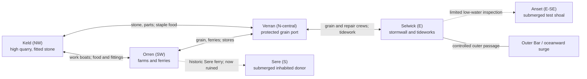
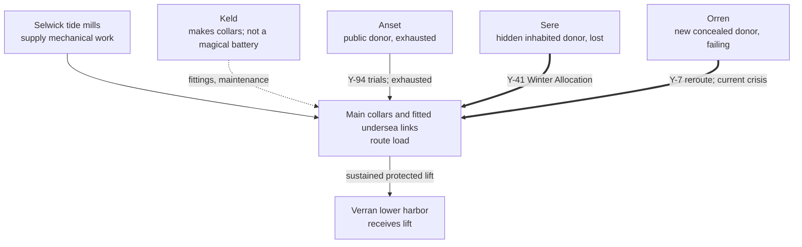
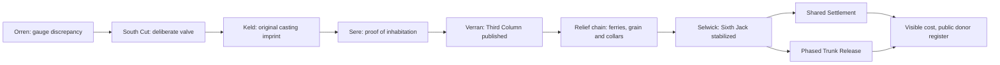

# Inner Sound: route, load and evidence schematics

**ID:** WRL-004 · **Status:** WORKING · **Scale:** conceptual, not a surveyed map. Use alongside [atlas](atlas-and-societies.md), never instead of it.

A map must explain *two* systems that share locations but should never be confused: **boats move people and food**, while **fitted sills move strain**. Both create dependencies; only the latter can lower an island.

## 1. Topology of travel and trade

**Legend:** solid lines = active controlled passages, dashed = historic or restricted access. Position left/right suggests flow of work, **not exact compass or kilometers**. Navigation changes with tide; at a small-scale level, an island contains its own causeways, ditches and work galleries.

## 2. Donor strain network: the controlled crime

**Causal reading:** Anset was the initial publicly acknowledged cost. When Anset's capacity failed, a small authority moved the donor side to inhabited Sere while continuing to report Anset. Later it moved to Orren. The **load route requires physical undersea fittings**; this diagram is not a supernatural mind-to-mind flow. Keld supplies equipment but is not itself automatically a load donor.

**Important:** the diagram does *not* imply that all three donors are presently donating equal force. Their arrows show **historical allocations** and the reason the current choices exist.

## 3. One route through the campaign

Every arrow needs an *in-game reason* why the next stop becomes necessary. A ferry transition is never enough by itself. See [campaign spine](../02-narrative/campaign-spine.md).

## 4. Geography contradiction checks

1. If Verran receives lift from Selwick's main trunk, why does the dangerous donor lie south? **Because connected fitted routes traverse the Sound; the undersea links are finite, mapped and maintained.** Mark them in future level plans.
2. If Anset is under water, why did early engineers accept the test? **It was publicly uninhabited and designated expendable by emergency authorities**, though ecological harms should not be erased.
3. If Sere is “lost,” why can people visit it? **Much is below ordinary high tide; a few built thresholds emerge at exceptional low ebb.** Lost = lost habitable ground and legal recognition, not magically inaccessible.
4. If Keld's rock is high, why not use it as donor at Y-41? **Its major high beds were poorly connected and its quarry fittings vital to repairs.** Future lower-margin sharing is possible with new fitments and limited evacuation, not a past no-cost solution.
5. If the sea is east, why is Orren southwest flooded? **The water level varies basin-wide; it is Orren's ground that fails**, plus storm surge through the east throat.
6. If everything is on one graph, why not simply disconnect a line? **Existing receivers lose support and loaded collars may release dangerous stored strain.** Safe phased operations are the Act III challenge.

**Before map lock:** create a measured plan showing undersea route lengths, the four islands' relative terrain tiers, drainage directions, high-/low-tide overlays, ferry durations, human settlement area and stormwall flow. A story map without those is only a diagram.