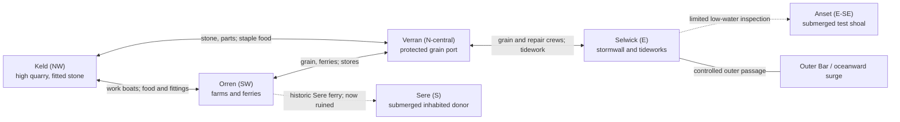
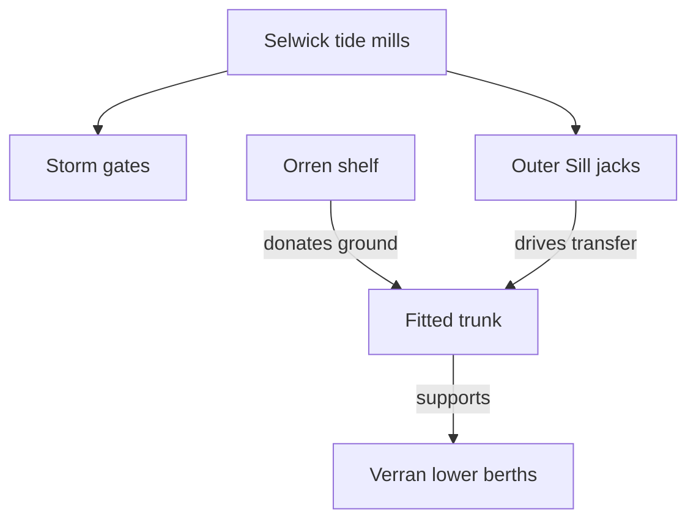

# Inner Sound: route, load and evidence schematics

**ID:** WRL-004 · **Status:** WORKING · **Scale:** conceptual, not a surveyed map. Use alongside [atlas](atlas-and-societies.md), never instead of it.

A map must explain *two* systems that share locations but should never be confused: **boats move people and food**, while **fitted sills move strain**. Both create dependencies; only the latter can lower an island.

## 1. Topology of travel and trade

**Legend:** solid lines = active controlled passages, dashed = historic or restricted access. Position left/right suggests flow of work, **not exact compass or kilometers**. Navigation changes with tide; at a small-scale level, an island contains its own causeways, ditches and work galleries.

## 2. Donor strain network: the controlled crime

**Causal reading:** Anset was the initial publicly acknowledged cost. When Anset's capacity failed, a small authority moved the donor side to inhabited Sere while continuing to report Anset. Later it moved to Orren. The **load route requires physical undersea fittings**; this diagram is not a supernatural mind-to-mind flow. Keld supplies equipment but is not itself automatically a load donor.

The diagram shows the working connections on the opening tide. For the two emergency settings, a fitter standing at the Outer Sill can trace the following routes.

| Setting | Ground and equipment in use | What runs out |
| --- | --- | --- |
| Shared Settlement | Two short relief spurs already reach Verran's **Washhouse Steps** and Selwick's **Net Yard**. Both were laid after Y-41 to test loads on narrow margins. Keld's crews bring replacement collars and fit them at the existing heads. The trunk serves fewer berths at reduced lift. | Each authorized stroke spends ground at both sites. Permission ends after twelve high waters. If either site withdraws earlier, or fresh assent is missing at expiry, the watch closes both feeds before another draw. It bleeds the load already held over successive cycles. |
| Phased Trunk Release | Crews unload the Sixth Jack under control and bring down support for the lower harbor in stages. The Selwick masonry wall stands on its footings and the tide gearing still turns its gates. | Verran loses lower berths as their approaches flood. Upper stores still exist, but small boats and hand carriage cannot replace a deep, working grain quay. |

At each shared stroke the watch at each spur seats its collar during the slack interval. Two indicators at Selwick answer to strain through the existing fittings. The common drive stays out until **both** return. The jack resets them on every return stroke. A silence can mean a withdrawn agreement, a runner delayed, or a fitting broken. In all three cases a fresh draw must wait. Crews bleed down the load already held. The next boat can bring an explanation.

Both settings leave the **Verran Ropewalk** out. Its occupiers refuse the use of their strip of working shore. A pin through the closed branch at the Ropewalk gives them a way to see that their answer holds.

## 3. The crossings after South Cut

The temporary hold buys six high waters. Tessa marks them from the first high water after the brace goes in. Keld and the Boat League work in parallel during the crossings. Making the player ferry every crew and every fitting would consume time they do not have.

| High water | Passage and constraint |
| --- | --- |
| First | The worker takes the maintenance passage from Orren to Keld. A Keld fitter can read the batch mark and make an impression while other hands begin their relief work. |
| Second | Return to Orren to pick up Ada and the shallow boat for Sere. Only the exceptional ebb after this high water exposes the Market Steps. Ordinary ferries draw too much water to land there. |
| Third | Come back through Orren and take the staple route to Verran with the shore tally. The hearing stops the lower hoist. The north ferry remains at the freight berth under load. Small boats still run. |
| Fourth | The worker attends the Verran meetings. At Net Yard, Renn's crew makes a preliminary walk with occupiers. Keld sends collars by its existing freight routes and Verran passes the Selwick fittings on by service boat. |
| Fifth | Cross Verran to Selwick with the relief crews. The worker joins the Net Yard occupiers on the ground before the terms go to the Outer Sill. The watch has the remaining interval to unload the reserve. |
| Sixth | Last safe high water of the South Cut hold. The crews must have the transition in hand at the Outer Sill. More time at Sere or another round trip for a reading would spend the same water. |

The [campaign](../02-narrative/campaign-spine.md) follows the boats and the families waiting on them.

## 4. Geography contradiction checks

1. If Verran receives lift from Selwick's main trunk, why does the dangerous donor lie south? **Because connected fitted routes traverse the Sound; the undersea links are finite, mapped and maintained.** Mark them in future level plans.
2. Why did the first trial use Anset? There were no homes on the shoal, and the trial could secure a working harbor. The people who beached their boats there for repairs measured the settlement alongside the engineers. Selwick crews now lift their boats on timber cradles.
3. If Sere is “lost,” why can people visit it? **Much is below ordinary high tide; a few built thresholds emerge at exceptional low ebb.** Lost = lost habitable ground and legal recognition, not magically inaccessible.
4. If Keld's rock is high, why not use it as donor at Y-41? **Its major high beds were poorly connected and its quarry fittings vital to repairs.** Today's short relief spurs at Washhouse Steps and Net Yard postdate the Winter Allocation. Keld supplies the fitters and collars.
5. If the sea is east, why is Orren southwest flooded? **The water level varies basin-wide; it is Orren's ground that fails**, plus storm surge through the east throat.
6. If everything is on one graph, why not simply disconnect a line? **Existing receivers lose support and loaded collars may release dangerous stored strain.** Safe phased operations are the Act III challenge.

**As the world map takes shape**, establish believable distances, terrain height, drainage, tides, ferry passages, settlement footprints and the routes of the fitted strain network. These details should strengthen the scenes instead of becoming another approval exercise.
