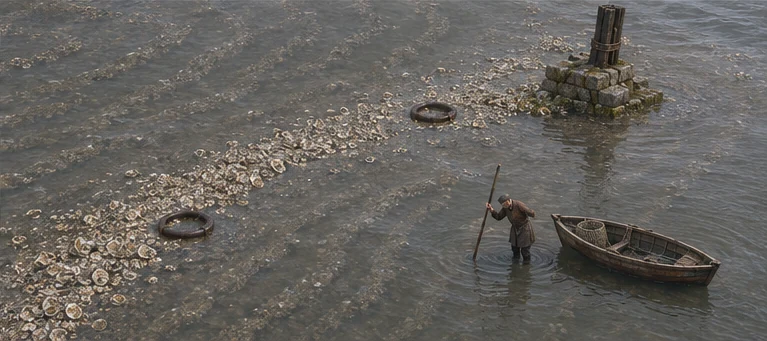
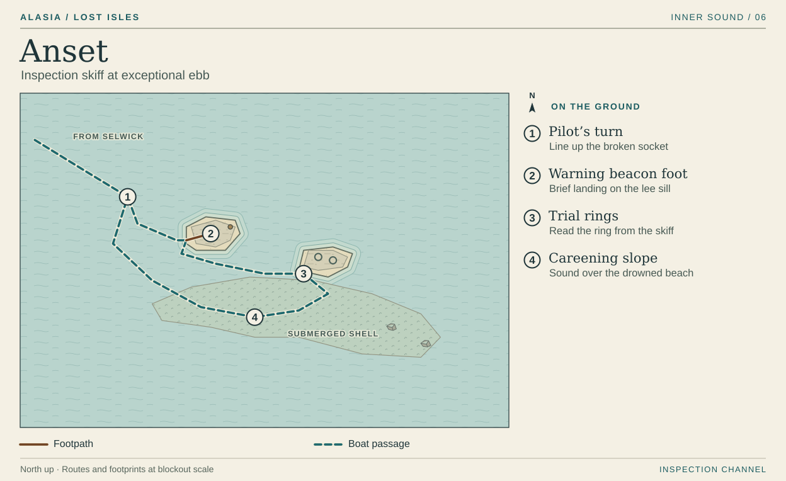

# Anset · The beach underneath the boat

At an ordinary low the old careening beach still lies under water. A Selwick boat once rolled on one side here while a caulker worked down its exposed hull. A boat brought to the same place today floats over its own repair floor.

This plan is a proposed short inspection from [Selwick](selwick.md) at a separate exceptional ebb. The six-high-water handover already has its crossings allocated. On that main route players experience Anset's loss by walking under the workboat on Selwick's cradles. The inspection can stand alone when the appropriate tide is available.

## 1 · Pilot's turn

Arrive from the northwest in a shallow inspection skiff. Seen from above, the broken beacon base opens from a narrow dark line into a four-sided socket as the boat turns around it. That change gives the pilot and player a recognizable approach even in flat light. Beyond the socket the water washes evenly over a long pale slope. Keep the open channel dark and unbroken so the player can follow the boat's return line. The only exit is back to Selwick.

## 2 · Warning beacon foot

Bring the gunwale against the short leeward side of the foundation. At exceptional ebb one broken masonry sill clears the wash. The player can step onto that lip and look along the fallen bolt holes toward the calibration rings. Frame the inspection skiff in the same view. The masonry stops within a few strides and the rope still reaches the boat. The next inspection position is across open water. Keep the beacon's contact shadow visible so reflected sky never makes the gap look paved.

The rising water washes over the same sill that served as a landing. Show the lapped top course on the departure view. During inspection, advancing or leaving is a deliberate action so the player has time to read the measurements.

## 3 · Trial rings

Pole round by boat to the small test foundation. A wave parts around the iron rim and joins again inside it. From the gunwale lower a marked rod beside the ring, then put the current reading alongside the public trial's two original entries. The engineer recorded the harbor's gain. The craft worker recorded how much water covered the caulker's iron at a matching tide. Show their datum and the skiff's present waterline in the same direction. The old iron was retrieved. The exposed fixture here is the ring.

Allow the reading from the boat. A low bell of metal against the rod and a notch crossing the surface give the same information. Dark weed collects inside the rim. Reserve the lightest edge for the thin exposed iron and the rod graduations.

## 4 · Careening slope

Take the short sounding leg over the shallower shell bed before returning, or turn back at the rings. Hold the skiff side-on to the slope. Along its near gunwale pale bits of shell show through in a strip the length of a hull. Along its far side the water is already too deep to see the bottom. From the seat above the old wear mark at the rower's heel, the player lowers the rod over the gunwale to touch the repair bed without putting a boot on it. A faint scrape of shell replaces the ring's iron knock.

Keep the entire shell bed below the playable water surface. The broken foundations are the only exposed shapes. Ordinary tides take even those landing lips out of use. The shoal remains an exhausted donor under either harbor setting. Eastward breakers belong to the Outer Bar beyond Selwick. The inspection pilot turns back into the Sound.

[Inner Sound atlas](../playable-world-atlas.md) · [Shoal and trial history](../atlas-and-societies.md) · [Crossing schedule](../network-and-route-map.md)
