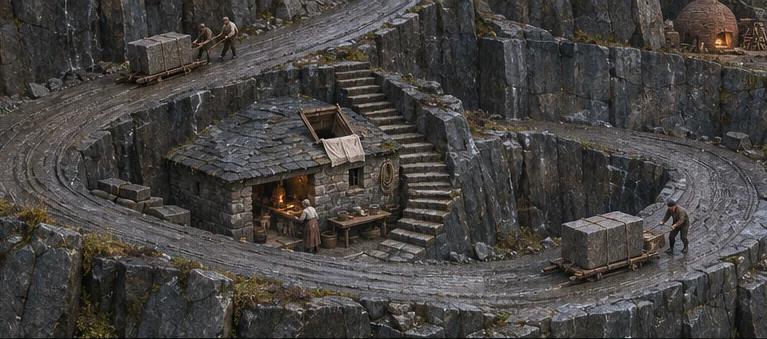
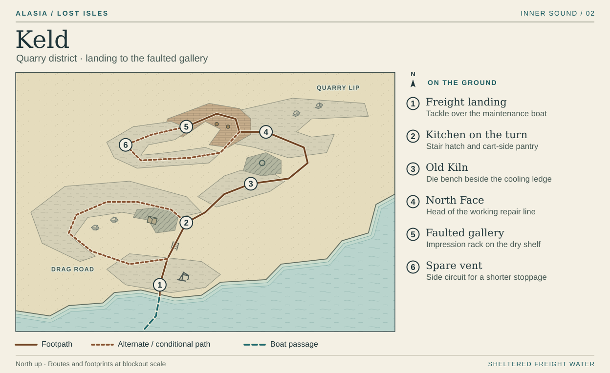

# Keld · The quarry road

At the freight landing you can see the underside of a kitchen shelf. On the way back, at that same shelf, you can look down on your boat's masthead. Build Keld around those two views. The playable district climbs three shelves cut in the southeast flank of the plateau. The rest of the island continues above the North Face quarry lip. Rain drains down the cuts in the drag road and falls into the harbor through a single stone spout.

For a first graybox, allow two loaded sleds to pass on the outside bend and two people with bowls to pass on the kitchen stair. At the gallery mouth, narrow to one sled between posts. Beyond the mouth, leave one universal evade of clear stone beside each active floor seam. These changes in width should be felt before the lighting changes.

The first-high-water visit runs **1 → 2 → 3 → 4 → 5**, with **6** available off the gallery. Come back past the same kitchen to board for Orren. The plan cuts away the top of the gallery. Its roof is solid ground when seen from the bench above.

## 1 · Freight landing

The maintenance boat ties up bow and stern on the inner side of the freight tackle. Step across onto a square of granite polished at its corners by slings. A crew on the other side can lower dressed stone straight into the freight boat. Grain sacks come back uphill with the empty drag. Keep the landing work visible during embarkation and give the player a clear strip along the inshore edge.

From the post there are two ways up. Wheel grooves bend left around the outside of the quarry road. Short steps cut straight across the turn to the serving hatch at **2**. The stair doubles as the quick way back once players recognize the tackle head from above. On departure, the optional vent job changes which finished fittings are being loaded. The maintenance boat still sails on the same water.

## 2 · Kitchen on the turn

Put the pantry door flush with the outer cart road. One retaining wall uphill, put the serving hatch at elbow height on the stair. Both doors belong to the same narrow building. A carrier can set a sack down without climbing a tread. Someone on the stair gets a hot bowl without crossing the drag. Leave one full tread clear around the queue so a player who stops for the cupboard show can step aside.

A pale square of stretched sailcloth picks out the hatch beneath the dark road beams. Outbound, the cupboard doors are closed. Returning from the stopped line, the lamp is behind the cloth, the bird is moving and the people off shift have filled the stair. The setter takes his bowl back uphill if work can resume early. Otherwise he stays at the hatch and the cook carries his tab. The empty route down the outside stays available through both versions. Give the kitchen the small sounds lost on the upper bench, especially a bowl scraped clean and set down on stone.

## 3 · Old Kiln

Both roads lead to a level shelf outside the kiln. Put the die bench in the mouth of the court, crosswise to the ascent, so an arriving player sees the fitter's hands against wet, pale daylight. Coal-dark brick holds the heat. The side ledge has just enough warmth for the workers' flat cakes. The kiln mouth colors one edge of the court. It cannot light the quarry face above.

At the bench, turn the rubbing against the reference die until its little flaw meets the old impression. The rubbing carries the old batch mark underneath a newer inspection stamp. Keep this close work under the eave on a steady surface. The exit turns east along the kiln drain, then doubles north onto the quarry bench. From the bend the fitter can point to the timber head of the live gallery at **4**.

## 4 · North Face

A fresh rectangular bite in the rock marks the end of the drag road. Each lower bench is wide enough to turn a block on a timber sled. From above, three sets of parallel haul scars converge on the line head, so this busy space has a discernible entrance. The player comes in beside the last loaded sled and takes the empty side to the foreman. Place the wet rock face beyond the player, with the black opening against it. On camera-facing turns, cut the cliff back far enough to see a person standing against its toe.

The foreman calls a halt. Show the change all the way to the mouth. A sled settles onto its shoes, the line drops into its worn groove and a hand lifts the bar across the inspection side. The permission to go in and the loss of part of a shift are legible in the same movement. The stopped road stays a way out.

## 5 · Faulted gallery

From the head, the direct inspection shelf passes two uprights, turns behind a rib of standing granite and ends at the dry rack holding the matching impression. Set the first upright at the join between two floor slabs. A colony raises a branching ridge across one slab. The ridge stops at the open joint. At the next bay the player must cross such a slab to reach the rack; a short step onto the intact sill beside it clears the moving ridge. Worn tread, upright and exit stay in view together. A Shorer has a sound seat, a Sounder can work the connected slab and a Linewright can use the posts. A worker with the basic strike and evade has the full crossing.

Break off the decorative white veining at the floor. A faint branch that moves must be visible before it reaches a boot, including with the gallery lamps turned down. The loaded seam ticks against the stopped drag's silence. Put the rack in a two-person bay beyond the moving slab, with a full evade length between its backing and the seam. Give the rack a dry timber backing and clear floor around it so inspecting the impression after the crossing is a quiet act. Bring the impression out to the fitter at **4**. One impression travels with the worker. A duplicate leaves on the next service boat.

## 6 · Spare vent

At the first gallery fork the cut for the old vent runs along the downhill side of the stone rib. It is wide at its two approaches and pinches to a single work position at the vent. The direct shelf remains visible through slots above knee height. From the rack the player can take this side of the rib back to the line head. The dry rim around the open drain is the walkable surface.

For *Cold Fittings*, put the lever on the upstream side and the outlet in sight below the player's hand. When the worker sets the spare vent, a narrow stream starts running and the drag crew can shorten its stoppage once everyone is clear. The handle's angle and the water crossing the outlet show the result without a gauge overlay. Going straight back with the impression leaves the gallery safe to leave and the shift longer on hold. The detour, reading and retries stay within the first watch.

**Blockout test.** Stand on the landing, in the kitchen queue and on the North Face bench at ordinary play zoom. Check that the sling hangs over the hull at the landing, that the drag passes the pantry at the turn, and that its line can be traced to the sled at North Face. In the gallery, walk out from behind every upright during a ripple. A player must have a visible dry foothold and enough room to reach it with the universal evade.

[Inner Sound atlas](../playable-world-atlas.md) · [The kitchen on the turn](../island-life.md#keld--the-kitchen-on-the-turn) · [Crossings and freight routes](../network-and-route-map.md#3-the-crossings-after-south-cut)
