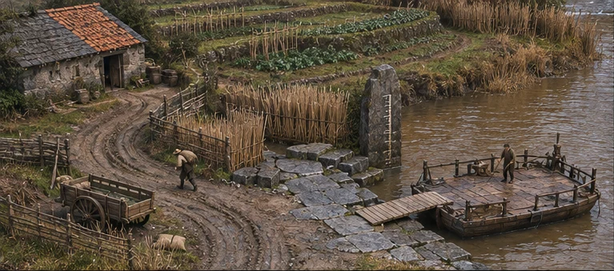
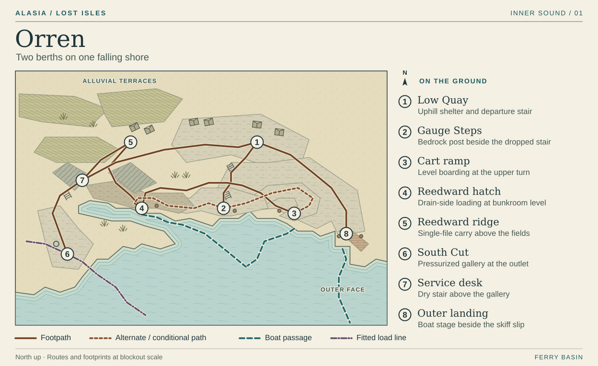
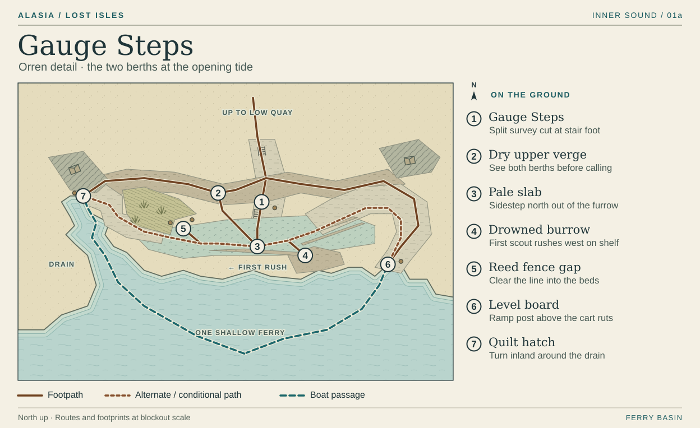
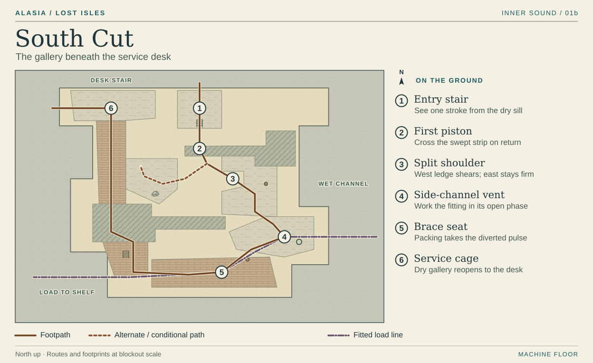

# Orren · The ferry basin

The highest thing on this stretch of Orren is a house with a dry floor. From its eaves you can see the roofs of the harvest bunkroom, people on the landing and a deckhand carrying the long board. At first all three seem within easy reach of one another. Down at the water, a difference of one stone course decides who can get aboard.

The map covers the opening district on the southwest island. On this plan the inlet opens to the south. Stand at **2** facing the water. Low Quay’s cart ramp lies to your left (east), the farm drain to your right (west). The dry stair behind you rises to the service desk. The submerged fitting at South Cut carries strain through the connected shelf. The pilot uses the open water outside the quay.

Clay dries buff on the wheel ruts and stays nearly black under a fresh footprint. Light the district with a broad gray sky. Under its eaves, the shelter window throws a narrow bar of amber across the dry boxes. Give the farm roof a woven edge and the quay roof a waxed, patched one. You should be able to tell which way you are heading from the edge above the path.

## 1 · Low Quay

Come down from the uphill shelter alongside a bench built between the stone feet of two houses. The domestic floor sits above your shoulder by the time the path reaches the rear stair. From here follow the outer edge to the working boats at **8**, or cut down the narrower steps to the landing at **2**. Leave an open wedge in the roofs between shelter and stair. Through it, you can pick out the broken wooden heron’s foot on the bow before the gangplank comes into view.

This is a safe place to prepare tools, speak to the boat crews and read the tide board. Keep the path to the ferry clear when the queue forms. Give the queue somewhere to go when a boat leaves. A strip of waxed canvas hangs over the terrace boxes, wide enough to tuck the cottage door underneath. The bare strip in the floor under the drip edge will still be visible when those boxes move.

## 2 · Gauge Steps

The control measurement fits in one view from the gangplank. One half of a mason’s cut is on the stair cheek, the other on the bedrock post. The water still reaches its usual mark on the post. Let the player handle the brace, bearing or anchor, see a deckhand cross with a test load and try the rope-ring toss while the landing is level. After the stroke, hold the camera there. The heron’s foot passes the stone tread, the lower half of the mason’s cut moves with the stair, and dark bedding opens below it.

Below the post, a pale slab crosses the shelf. One flooded burrow opens at its end, aligned *along* the shelf. The scout’s scrape should read from the safe stair, with room for a full sideways evade on firm ground. Set the broken reed fence beyond the burrow’s run so an animal can leave the fight. A player on the dry verge above the slab can inspect both mooring posts before calling the boat. Reserve this verge for people on foot. Clear its middle of stacked rope, gear and bystanders.

## 3 · Cart ramp

The cart ruts turn back along Low Quay’s east face. At the upper turn the stone is level with the shallow ferry’s deck. From below, sight up the straight ruts to the door laid across two boxes. On the player’s call the *one* shallow hull rounds to this post. The other two loaded boats are already pulling away on the outside face.

Draw the Mason up the ruts and step onto the slab beside the post. Its plate seats between the wheel cuts, exposing the rear hinge until it works loose or the scout strikes its flank. The fence gap gives a charging animal somewhere to run past the worker. Only when the approach clears does the crew lay the board and let two passengers cross side by side. Keep the boat’s loose hemp behind the post so its outline stays distinct from a Linewright’s taut cable.

## 4 · Reedward hatch

The towpath follows the inside of the drain. From the Gauge Steps move a few paces along the dry verge. The bend hides the boat-sized hatch until a picker lifts a pale quilt into the opening. The bunkroom’s raised sleeping shelf sits above the sill. Loading from here slides a whole tied bundle onto the long board. The ridge path behind the house takes the same quilts uphill one carrier at a time.

Coming down the dry verge gives access to the Mason’s rear on the narrow bend. Position the camera so the player can see the scout’s scrape on the higher end and the length of its downhill run. If the bend hides that second animal, bring it out after the Mason’s first charge. The pale slab seats a brace, the bank interrupts a sounding across the ditch, and the standing foot of the reed fence takes a hook. Both the hatch and cart ramp can be cleared with ordinary strikes and an evade. On a retry after the pilot’s call, put the boat back on the chosen approach with its plank still aboard.

## 5 · Reedward ridge

Leave the hatch through the back of the bunkroom. The footpath follows the compacted crest of a field bank to the terrace above South Cut. Ridges of bean stubble show the fall of the fields into the drain. Household flood cuts appear on the cottage feet at different heights. Where water has breached a field, a collapsed woven panel lies flat enough to see the flooded burrow through it. Keep the intact windbreaks below shoulder height beside the path. On this stretch the player hears the bunkroom keeper from below, then loses sight of the roof as the ground levels out.

Give the uphill carriers passing pockets at house doors and leave the through-route usable with either berth chosen. At the terrace fork, the worn dry stair leads back to Low Quay. The lower stair skirts the service desk and descends into South Cut. The white packing at the gallery mouth is visible down the second flight. A player who has spent the quiet walk on the ridge can locate the working machine by its double knock before the gallery roof cuts off the daylight.

## 6–7 · South Cut and the service desk

Enter **6** one terrace below the desk at **7**. In the room plan, the first stair ends *outside* the piston sweep. From it, watch the pale vein take load, the crosshead pass its scuffed mark on the floor, then the vent uncover. The operating plate shows one return. The linkage catches twice, visible in a momentary second travel of the rod and audible as a double knock. Bronze stays dark except where hands have polished a grip. Light from a slit in the bank falls across the rod and its fixed witness mark.

Cross on the return and work from the split shoulder. The west shoulder loses its outer stones as load builds. Frame the intact east shoulder and its continuous dry edge before the west gives way. From the east, all three starters can reach the exposed side-channel fitting and secure the brace on a slack stroke. The pylon can take a line, firm stone can seat a brace and the visible double return can be timed. Keep player actions at the side channel. Behind the grille the donor fitting continues down into Orren’s shelf.

When the piston settles the hand opens the dry service cage. Via its protected stair, return to **7** and the desk where inspection copies can be spread flat. A slit facing the pier foot gives a view of daylight under the loaded pier. From the desk the old runner’s stair goes straight back to Low Quay. The packing will take five high waters and needs relief by the crest of the sixth. Leave the brace under load on the walk out.

## 8 · Outer landing and return

The outer face has room to berth a maintenance boat. A short slip alongside holds the optional beached skiff. Its repair trades freight space for an extra passenger run. Show the difference from the long-board ferry at a glance. The skiff has a high gunwale to climb and two short benches. Beyond the boat, staggered posts and open water give the outgoing pilot a clear lead out of the inlet.

Come back from Keld at the second high and take the upper walk from **8** to **1**. The cart ramp is shut. If the passengers went first, doubled quilts drip from its rail and the brothers come out under the eaves in one coat. If the bedding went first, dry quilts fill the uphill rooms. The waiting couple’s door still spans the boxes and the player can carry its light end to the new boarding place. Both walks return to the same landing for Ada’s shallow boat to Sere. Looking, exploring and restarting an encounter take no high water off the board.

[The long board](../../03-gameplay/orren-field-sequence.md) · [South Cut apparatus](../../03-gameplay/enemies-loot-and-progression.md) · [Sere at exceptional ebb](./sere.md) · [Inner Sound atlas](../playable-world-atlas.md)
