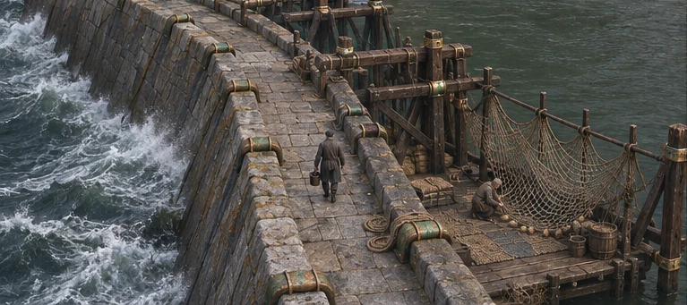
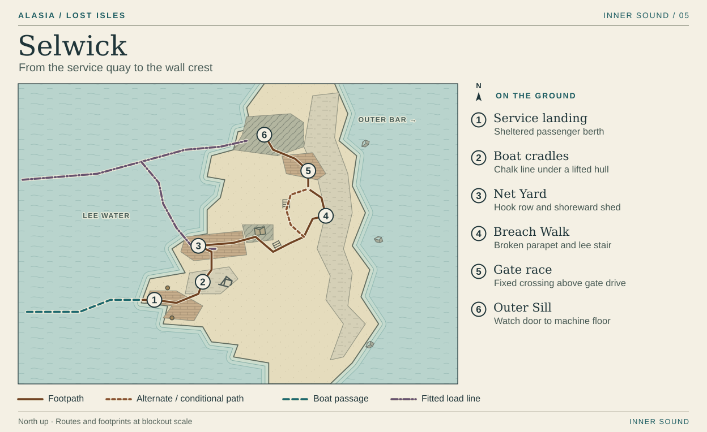
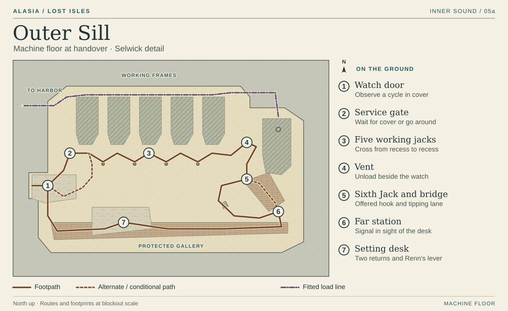

# Selwick · From the lee to the Sixth Jack

The service boat comes in from Verran with the wall between its passengers and the sea. At the first bend, white water reaches the height of the lintel the player just walked under. The route climbs from that still landing to the crest, then descends inside the machinery that keeps the passage usable.

## 1 · Service landing

The pilot lays her boat against a quay that turns inward like an elbow. Give passengers the inner corner to disembark and leave the head of the quay to the crew rolling heavy collars ashore. Both flows appear in the arrival frame. The quietest place on Selwick is the little patch of dry stone immediately behind the landing door. Rope knocks against a hull on the water side. On the other side a pressure wave makes the latch jump.

Land with the relief crew on the fifth high. The player goes up the collar ramp to the cradles. For the return trip, the empty collar chocks make the passenger turn easy to recognize. The homeward boat still calls here under either setting.

## 2 · Boat cradles

Two padded timber saddles lift a workboat high enough to see daylight under its keel. Walk its length along the wall side. The caulker's chalk line vanishes under one pad, comes back, then vanishes under the second. Leave room around the bow to see her waiting at the slings for another pair of hands. She used to have a whole sloping beach for this work at [Anset](anset.md). A low edge on the yard side keeps the hull from hiding the next door in the gameplay camera. The tapping stops exactly where the chalk does.

## 3 · Net Yard and the shoreward shed

Turn through the water-facing door onto one uninterrupted rectangle of floor. Short hooks run along the far edge. While the player carries one end of the winter net, the pilot walks the opposite edge through her father's hands. The floats pull into line just as the player reaches the inside door. Scale the apron to that action. The hooked edge must remain visible when the player reaches full stretch. A shoal of sprats in the lee throws a moment of silver onto the underside of the door.

Take the same net uphill through the shed's double doors. Nearly half the web piles up behind the player. Both places can hold the bundle. Only the apron lets someone follow a crooked row of mesh all the way to the tear. Keep the shed sill, the runner's path to the local spur and the steps to Breach Walk above the marked donor footprint. Clear the apron before the local watch can offer its ground.

On the way home after a shared draw, look down from that dry sill. Saltwater has crossed the hook row and the bundled net leaves by boat. Stopping the draws later leaves the floor lost. Under phased release the father sits back down at the hooks. The open water doorway frames him from the return path.

## 4 · Breach Walk

From the back of the shed, a dogleg stair comes up facing the outer sea. Turn north. The crest narrows at a missing length of parapet. A loaded stretcher can make the bend only by turning into the sheltered recess at its southern end. Let the player walk in ahead of the carriers and make room or take the short lee stair and rejoin beyond the bend. Both routes stay on built stone. At the exposed turn the seaward coping goes pale with spray. The walking surface stays a darker matte strip, with dry leeward pockets behind the buttresses. The camera holds its bearing as the surf comes up. The parallel lines breaking beyond the outer face are the **Outer Bar**, the limit of the chart in that direction.

## 5 · Gate race

The crest comes down beside a slot in the wall. Look through the guard rail and follow a slow wheel from the water to the iron gate spindle. The footway crosses on a fixed stone head and enters the sill building on its inland side. The wheel and its moving shadow remain below the footway. A separate bank of return rods sounds from inside the building. On the walk back after a phased release the spindle still turns while the harbor jacks bleed down. Use the same view both times, so the player can see which machine is still doing its job.

## 6 · Outer Sill

The inset numbers belong to the machine floor. Follow the bronze housings along the head of the five working frames. They seat against a single dark fitted header that turns west into the harbor trunk. Set a cutaway behind the rail at its elbow so the player can see where the iron meets the stone. The shutters light the back of each moving frame. The worker stands out against a plain working deck between the frame shadow and a recessed shoulder. Keep wet shine, tally boards and hanging chains off that strip.

| Floor station | Geometry, action and return |
| --- | --- |
| **1 · Watch door** | Enter from the gate race onto a stone landing behind a knee wall. From here see one full cycle before stepping into working space. The warning combines a double ratchet, an advancing rectangular shadow and a moving gauge tongue. |
| **2 · Service gate** | A defender holds the direct opening until her partner signals cover. Wait in the stone return or follow the short service passage behind her to the first frame. Both approaches keep the crew alive and join before the first moving shoulder. |
| **3 · Five working jacks** | Cross the mouths of five square bays. The masonry between mouths gives a full body shelter. Stop, read the next shadow and cross to the following recess. Keep every crossing possible at normal movement speed after the return stroke. A profession tool can change the crossing rhythm. The farthest bay ends at a stair to the vent. |
| **4 · Vent** | Turn back toward the five frames from the vent wheel. Work with the watch to vent the current load. The working rods ease off. The scarred sixth return sticks against its guide, with the second knock first heard at South Cut. The watch lifts the gate on the down stair beside the reserve. Until the load is vented that gate rests under the end of the return rod. |
| **5 · Sixth Jack and bridge** | At the bridge head the defender offers the wooden end of her hook. A loaded cart starts to tilt in the same camera frame. Both targets sit within one movement interval of the same safe shoulder. Take the hook and the bridge folds behind her. Take the brace point and the carts keep their lane while her crew pulls her clear with an injured hand. Every profession can do either job. |
| **6 · Far station** | The fixed stair around the bridge pier reaches the far side even with the bridge gone. The rescued defender joins the hand-carry line on these steps, or gives the next signal with her uninjured hand alongside the carts. Keep the far signal visible across the floor from the setting desk. |
| **7 · Setting desk** | Return along the sill wall to the desk. The player reads the authorized boundary back. From the operator's position see both local-return indicators, the far station and Renn's lever. The gallery ends at a drop bar visible from the watch door on arrival. The duty hand lifts it after the setting so the crew and player can walk back to the landing. |

A shared stroke takes fresh returns from **Washhouse Steps and Net Yard**. The indicators drop back after each stroke. Either missing return holds both feeds closed while existing load bleeds away. At the sixth high Renn seats the authorized setting after the far signal. The shared mandate ends after twelve high waters or earlier withdrawal. At expiry the watch begins phased release unless both sites renew after fresh readings and have capacity. The phased setting closes the donor feeds at a safe boundary and releases the harbor trunk over successive cycles. The work sheet beside the desk shows Ropewalk struck through. Its occupiers can check the physical pin at Ropewalk. The separate gate gearing heard outside keeps its own beat.

[Inner Sound atlas](../playable-world-atlas.md) · [Local landing and net handling](../island-life.md) · [Handover and public settings](../../02-narrative/campaign-spine.md)
