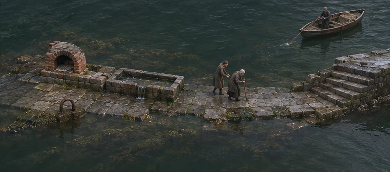
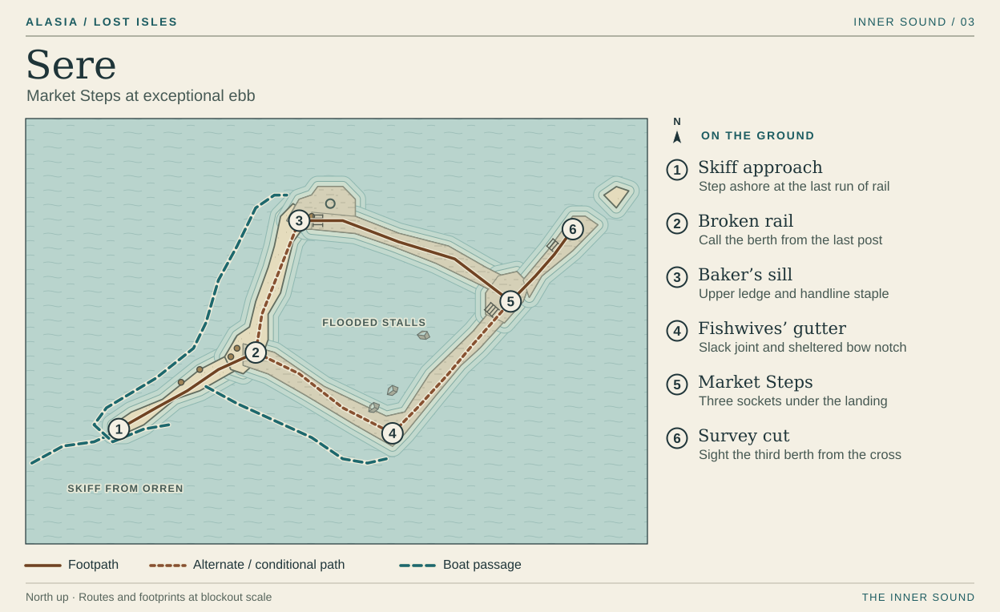

# Sere · Market Steps

Approach low in the water. The first thing tall enough to catch an oar is a handrail. Farther along its line Ada reaches for the next length and puts her whole hand into open air. From the skiff the market reads as three detached scraps of masonry. Moving round them reveals a high shop threshold, a drain below the fish stalls and the stair both trades once used to meet the ferry.

This plot keeps the six positions and foot connections of the [playable browser chart](../../../studies/market-steps.html). The camera and material notes below describe their translation to a 3D environment. Only the ebb after the second high opens this passage. A low, pearly sky puts a pale edge on the high sill. The gutter reflects green water below the knee. Leave the broken iron almost black so a missing rail reads against either surface. The rectangles seen through the water between the two walks are flooded cellars. Give their tops a soft submerged edge. Reserve a sharp, dry contact shadow for stones a person can stand on.

## 1 · Skiff approach

Orren lies to the north. The pilot comes round the west side of the drowned street to approach the rail along its length. The last strokes bring the sound of oars close against stone, then just a shoe and a thump against the gunwale as the player steps ashore. Keep the boat low enough in frame that Ada and the rail remain visible beyond its bow. The length of stone behind the player dips back into the Sound after the pilot goes round. Departure will be from her chosen berth.

## 2 · Broken rail

Put one upright at the turn and let the next surviving stump just break the surface. Here the player can see the iron staple in the high sill to the north and the bow-sized notch below the gutter to the southeast. Send the skiff to the sill and the pilot can reeve a handline. Send it to the gutter and she can hold a shorter return berth. In that case Ada waits at this post while the worker takes a line round by the oven or quiets the loose stone below. Keep the last post visible across both approaches. On the way out it is still the easiest shape to find from water level.

## 3 · Baker’s sill

A few courses of the oven vault make a crescent when seen from above. Its open mouth faces the lost street. Beside it a long groove runs at a child’s thumb height, where a spoon used to scrape the edge after the trays came out. When Ada is here, the player can put a thumb into the groove. The mud looks black on skin. The rented room behind the oven survives as a change in the line of the underwater wall. That sliver of wall is enough to give the room a place on the map.

Follow the top of the sill round the back of the oven to **5**. On the outward crossing keep a fragment of the lip framed between the pilot’s bow and Ada’s feet. It chips away when the pilot brings the rope up. If the pilot waits at the gutter instead, the worker can still bring the end round the staple and guide Ada across. After the tally comes out, open water cuts **2–3**. A player who walks to the oven again can return to **5** along its surviving eastern end.

## 4 · Fishwives’ gutter

The lower route bends around a pair of stone rebates where the fish sellers leaned their boards to drain. Keep the inboard wall high enough at the bend to throw a spoken call back from below the landing. Give the resonant answer a caption. The chalk hazard has a different position and shape. It crosses the walking line at the joint where a loose paving stone flexes with the wash.

One wash has three visible positions. On slack water the stone lies flat and the worker can turn it over. Rising threads leave time for one transit. With the comb standing, a step towards or away from **4** makes the worker pull their foot back onto the same stone. A player may wait on the dry lip to see the whole cycle. Turning the stone once splits the chalk bed. Water then passes through the open joint on every wash, including the return. Ada can come through that quiet bend on the worker’s shoulder. Once Ada has a secure crossing by the high handline, the pair can also time a live gutter on the way back.

## 5–6 · Market Steps and survey cut

Both walks meet at the foot of a fan of worn landing treads at **5**. From the bottom, three empty-looking sockets sit in a row under the overhang. Climb one short run to the salt-filled survey cross at **6**. A person standing there can sight directly back to the third socket. Let the player hold the rubbing flat while Ada marks that alignment. On the return to **5**, Ada tips the rounded end of the brass loose. Show where the metal has been rubbing inside the socket. The small bright edge remains after the brass is gone.

When the west lip falls, hold the view wide enough to see the severed path and where the pilot can put her boat. Give the missing length a clean open-water silhouette even at low reflections. The state of the gutter now matters more than the distance walked.

| Where the pilot waited | Inbound passage | Return from the sockets |
| --- | --- | --- |
| Baker’s sill | The pilot secures the handline from **2** to **3**. Walk round the oven to **5**. | The skiff drops back to the last post. Descend **5 → 4 → 2** to board. |
| Fishwives’ gutter | From **2**, carry a handline round **3** or turn the loose stone and guide Ada through **4**. Either approach reaches **5**. | The skiff holds the notch below **4**. Descend **5 → 4** to board. |

Footsteps on the high course should sound hollow and distinct. The lower stones carry a close suck of water even after the chalk goes quiet. At departure the pilot holds off for a moment and the last dry corner of the oven goes under. There is no ordinary-tide walking return. The skiff goes back through [Orren](./orren.md) for the third-high crossing to Verran. Reading the chart or inspecting a memory spends no wash.

[Market Steps movement and tide states](../../../studies/market-scene.js) · [The return trip](../../02-narrative/writing-and-quest-standards.md#sere--the-return-trip) · [Inner Sound atlas](../playable-world-atlas.md)
