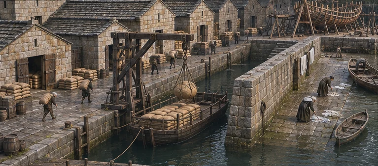
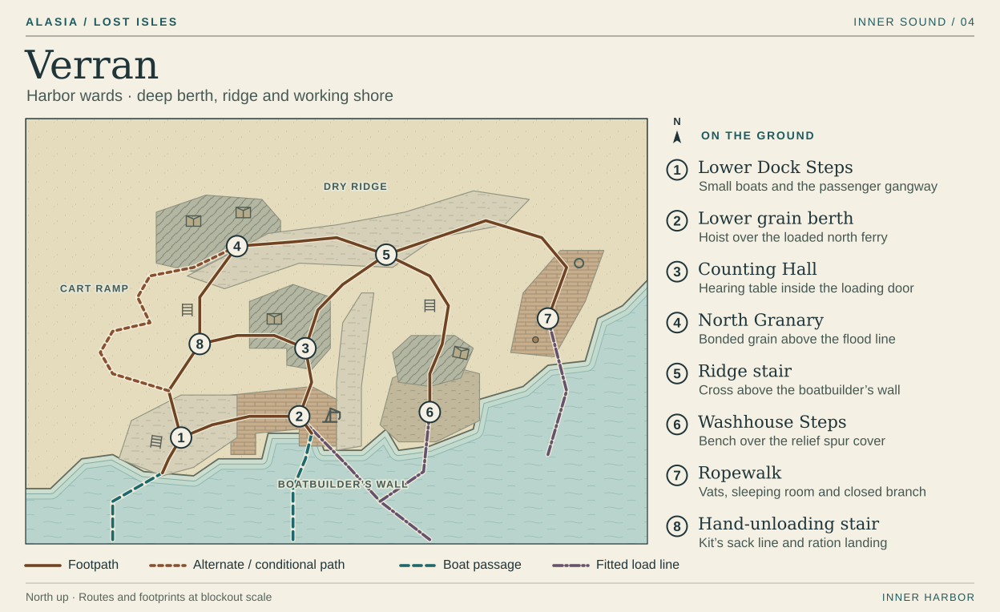

# Verran · The harbor under the ridge

Verran's skyline is a row of grain doors at different heights. Approach by boat and their thresholds briefly line up. As the boat turns, the upper stores remain on rock while the lowest doorway comes into view on a plinth with three different courses of repair. From the first step ashore, keep one wet hook and one dry grain door in the player's bearings. How a sack gets from one to the other changes over the visit.

| Visit | Walk to lay out |
| --- | --- |
| Third high | Arrive at **1**, pass the loaded ferry at **2**, go in by the loading door at **3**. Leave by that door, then follow the grain from **4** down to **8**. |
| Fourth high | Join Kit on the stair at **8**. From the ridge crossing **5**, walk out to the Ropewalk **7** and bring the revised boundary back. Descend the opposite stair from **5** to see the Washhouse footprint at **6**. |
| Fifth high and return | Take the shallow service landing at **1** for Selwick. On coming back, climb to **6**'s upper landing under Shared Settlement, or carry a sack from **1** to the ration measure at **8** under Phased Trunk Release. The same small-boat steps serve the passage home to Orren. |

## 1 · Lower Dock Steps

Cut the landing like a comb into the west apron. The outer finger carries a passenger gangway. Two broad treads inside it let shallow boats tie higher or lower as the tide turns. From the approach, families waiting on the next run stand above the player's eye line while a loaded ferry sits so low at **2** that only a sailor's cap moves above the quay edge. Chipped survey cuts on the stair remain readable beside their newer neighbors. Carry the same courses round the corner onto the grain berth.

Turn east at the top to reach the hoist. Turn uphill for the hand-unloading stair. Put the passenger caller on the split between those paths. The caller can take a notice down to a departing skiff even with the deep ferry fast alongside. A countersigning service hand meets the worker at this split for the Selwick passage.

## 2 · Lower grain berth

Make the quay an L. The deep face takes a hull and a powered sling. Its short return holds a freight shed, the uncovered sack cart and a flat carry into the dry. A scuffed patch in the boards records where wet slings come to rest. The mechanism works overhead. Put the packed queue behind a rail so passing players can come close enough to see grain leaking from the sling without walking under it.

A bullseye of old stone under the hoist marks where the main fitted trunk supports the berth. Trace that line out under the water on the chart. The lifting tackle above it handles cargo. On the public reading, the crew doubles the stern hitch and leaves the hook idle. Keep one empty sling turning slowly in the wind while a shallow boat rows underneath. The warning bell changes which of two jobs the ferry hands can finish. Ring for the reading at once and the hands get the sacks under cover as their launch pulls away. Give the warning bell and they clear the gangway and catch the launch while the sacks take water. The loaded ferry misses its sailing in either case.

## 3 · Counting Hall

Step from the shed up a short loading ramp into the public bay of the hall. Its big doors open downhill onto the elbow of the L. Set the table against the side wall, perpendicular to the doorway. At normal play zoom the two ferry hands, sack cart and head of the last gangway should fit in the wedge visible past the clerk's shoulder. Keep this bay within one short walk of all three. For the first blockout, put the two hands four walking strides outside the sill, with the cart and the gangway to either side. Test that group at ordinary game zoom before sizing the rest of the bay.

Freight books sit in a shallow record aisle behind the counter. Bring three slips to the table and compare them with the shore tally. The porter's unloading mark on the freight counterfoil accounts for passage 71. The hall's older archive ends at a guarded gate beyond the aisle. The required counter, hearing table and bell pull are all on the public side. Leave the papers in place while the player checks the earlier receipt bell against the later work order. The clerk can hold a hand out for the copies through the same door that frames the waiting crews. The posted copies are still there when the player walks out. The study already plays the paper comparison and Kit's later shift. This floor plan gives those actions a walkable home. [Market Steps](../../../studies/market-steps.html)

## 4 · North Granary

A stepped group of masonry bins sits back from the ridge edge. Dry stone dust inside the bonded door catches the boot marks of the first carriers. Make the sealed door face the long stair, so its opening visibly connects a dry reserve to a hungry queue below. Keep the store shallow enough to see the pale empty rectangle that a stack of sacks leaves against the dark wall.

Three lines meet at the door. The ridge lane goes east to the wards. The straight, stepped carry descends to **8**. An older cart ramp folds down the west face of the store court and rejoins the landing road below that stair. For *Above the Waterline*, set a stranded handcart crosswise at the tight turn. Move it into the passing bay to admit loaded carts in one direction at a time. Watch a small load go up from the ferry while carriers take bonded grain down. Extra freight reaches the dry store and shortens the later queue. The powered hoist stays idle during relief.

## 5 · Ridge stair and boatbuilder's wall

At the ridge crossing the deep berth and the wash landing almost touch in plan. Give the player a view downhill along the dividing wall before they descend. A porter at **2** can hear a wet coat slap a board at **6**. To take that coat there, the porter must come up to this crossing, go round the blunt inland end of the wall and descend the other stair. Build the wall directly into the slope, with no passable sill at water level. The end on the ridge gives a reliable turn in both directions.

The western flight has worn hollows from grain sacks knocking at hip height. The eastern flight is dark on its inside turn where wet oilskins brush the stone. Above it stands the dry relief room facing a blank wall. Let two people carrying a rolled mattress actually make that corner and reach the door. Keep the stair wide enough to turn, tight enough that they have to lift the heavy end. The branch along the crest leads east to **7**.

## 6 · Washhouse Steps

The ridge stair comes down behind a wash bench. On its far side, a sloping apron lets a crew push a sodden coat straight from their boat into the washroom. Put a tank under the eave where roof water can feed it. A sleeve flattened over the board leaves two pale salt crescents. From the indoor bench the player can see the low sill of the renters' room and, through the other doorway, the level of the approaching boat. Use lamplight for the bed space and cool reflected water for the working floor.

Slide the bench aside to inspect the flush relief cover. The spur comes in under this apron on its own fitting. On the fourth watch, carry the mattress up to the dry room with Moss or bring it back down if the occupants decline. The two keys have to work at the upper door. A player who has made that journey knows what has to move before any ground can be used.

On a shared setting, saltwater crosses the workroom floor. Keep the lower doorway visible from the last dry tread. Benches and stools have moved uphill, and the next twelve high waters are on the occupier's copy at the upper landing. In phased release the boat can still push the wet gear across its old sill. A porter carrying the coat to the deep berth still has to climb the ridge.

## 7 · Ropewalk

Turn off the ridge onto a narrow strip of firm shore. Lay long, parallel rope beds along the shore, with turning heads at the far end and vats on the landward edge. Hang one incomplete length at knee height in its working lane. The walkable lane runs beside it, and the braid thins as the player follows it toward the head. At the vats, turn through the narrow yard to find a low inhabited doorway. That turn puts a family in the small square the preliminary drawing left blank.

Walk the short side of the square with the occupier. Return to the crew outside the vats, where the cap of the closed branch can be inspected from the public lane. A pin goes through the housing with the head left plainly visible. Leave the turning lane in use and the bedding dry when the player comes back under either setting. Color the tar on the vats warm brown in sunlight. The pale end of the pin stays visible against its dark housing.

## 8 · Hand-unloading and ration stair

Put this stair on the direct line between **1** and **4**. Cut a half-landing for the measure and a deeper recess on the uphill side for Ada's book. Leave a continuous walking lane down one edge. The returning carrier can pass a waiting household and a player can turn off into the recess while the queue keeps moving. The shortest path to the steward on his break runs past Kit's place on the carry. Take her end of a sack and she can reach him two steps up. Leave the job with her and the same shelf carries the open page, its witness space marked with sacking.

On the phased return, bring the player up this same stair holding one of the small lots from the lighter. The line stops when a porter sets his sack down to let a woman through with her measure. Show the new filed line inside the old scoop at hand height. On a shared return, a reduced grain run still works at the deep berth. Leave the Ropewalk pin and the route over the dividing wall visible on the walk back to the boats.

**Blockout test.** Walk from the deep berth to the wash bench while following a porter, then do it carrying the mattress in the opposite direction to **5**. Check every tread for a false shortcut. At the hearing, cover the on-screen objective and stand at the bell pull. A player should be able to point to the uncovered grain, the gangway and the pair who could work either one.

[Inner Sound atlas](../playable-world-atlas.md) · [Two sleepers](../island-life.md#verran--a-room-with-two-sleepers) · [The hearing](../../02-narrative/writing-and-quest-standards.md#verran--a-place-at-the-hearing)
