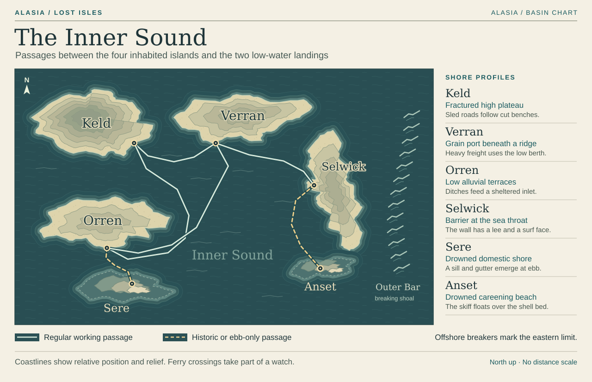
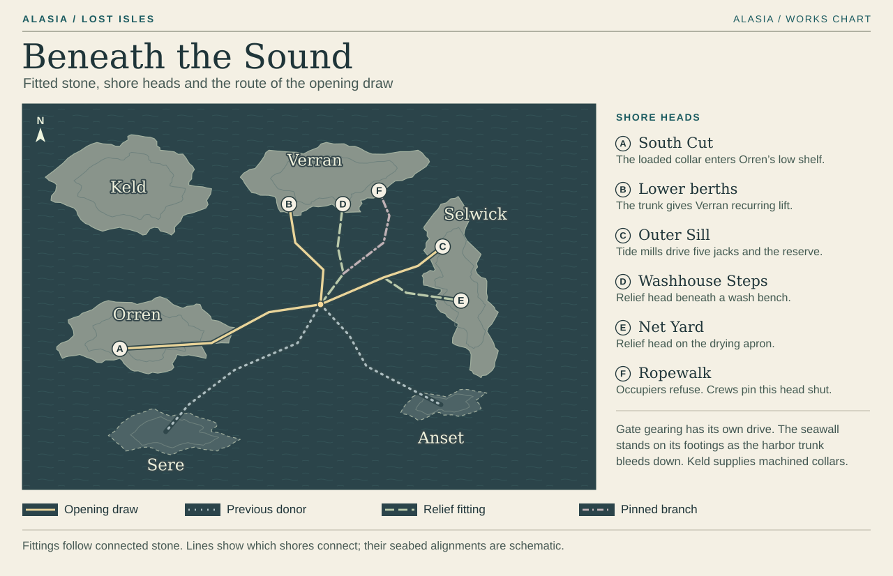

# Alasia · The playable Inner Sound

On Orren you can look across a ditch and see the quilt you came for. Getting it onto a boat is another matter. On Verran you can stand within earshot of someone washing a coat and have to climb a ridge to reach them. Build these shores at the scale of the thing someone is trying to move. A passenger, a block of granite, a sack of grain and a winter net each need a different kind of street.

## Land ashore

Each plan follows the part of the island a player can reach. The local numbers restart at each landing. The close-ups at Gauge Steps, South Cut and Outer Sill have their own keys.

| Shore | What to look for from the boat | Route on foot or by skiff |
| --- | --- | --- |
| [Orren · The ferry basin](playable-atlas/orren.md) | A wooden heron's foot on the ferry bow, almost level with a stone stair. | Come down from Low Quay, measure the drop at Gauge Steps, choose a berth, follow Reedward's drain and ridge to South Cut. The uphill stair brings you home above the damaged ramp. [Landing shelf](playable-atlas/maps/gauge-steps.svg) · [Sluice gallery](playable-atlas/maps/south-cut.svg) |
| [Keld · The quarry road](playable-atlas/keld.md) | A kitchen shelf above the masthead and the tackle for swinging stone directly into a hold. | Take the bowl stair through the bend in the drag road. Climb past Old Kiln to North Face and enter the stopped line. The spare vent gives the return from the impression rack a second purpose. |
| [Sere · Market Steps](playable-atlas/sere.md) | A handrail high enough to catch an oar. The next length is missing. | Send the skiff to the baker's sill or the fishwives' gutter. Both approaches serve the same steps. The loss of one ledge changes the walk back to the boat. |
| [Verran · Harbor wards](playable-atlas/verran.md) | From the queue, the head of a sailor on the loaded north ferry passes below the hook. | Walk from the passenger steps to the hoist and Counting Hall. Hand-carry down from the North Granary. The only foot crossing between the deep berth and Washhouse Steps lies uphill. Ropewalk has its own working shore. |
| [Selwick · Wall and sill](playable-atlas/selwick.md) | A quiet landing in the lee. On the other face, white water reaches the door lintel. | Pass the boat cradles, spread the winter net, climb Breach Walk and cross the gate race. Inside the Outer Sill, cross five working frames before the reserve and its two return paths. [Machine floor](playable-atlas/maps/outer-sill.svg) |
| [Anset · The careening beach](playable-atlas/anset.md) | A broken beacon foot and a trial ring stand above the old shell beach. | The skiff puts in at the foot and poles round to the rings. Sound over the former repair bed from the gunwale. This separate inspection fits a suitable exceptional ebb outside the six-high-water handover. |

**Outer Bar.** Look east along Breach Walk. Parallel lines of surf stand up at different distances and break in the same place on each swell. A workboat has room to turn in the dark water on the wall's inner side. Beyond the crest the white water runs across the entire approach. The player can follow the wall to the gate race. The breakers form the seaward boundary of the game.

## How far the camera should let you see

Use the proposed 55–60° camera above the ground plane. Keep a fixed bearing through each encounter. As a first blockout, frame roughly **20 metres across at the player's feet**, assuming a worker about 1.7 metres tall. Measure again with the actual movement speed, universal evade and HUD. The local plates enlarge junctions to make their choices legible. Their line lengths do not measure walking distance.

| Place | First blockout dimension | What must fit at ordinary play zoom |
| --- | --- | --- |
| Gauge Steps | About 8 m of clear stone along the charge, with a lateral evade lane on each side. | The scrape before the scout commits, its full run and the verge the worker can step onto. A few paces along the verge reveal the other berth. |
| Keld kitchen | A 2 m stair cuts inside a hairpin broad enough for two loaded sleds to pass. | From the hatch, the player sees a carrier put down a sack on the road below. The retaining wall can fade above shoulder height. |
| Sere gutter | Keep the bend and its nearest waiting stone within about 5 m. | The chalk comb, Ada's footing and the next dry contact shadow remain identifiable with reflections turned off. |
| Verran ridge | Place the two low landings within one 20 m field of view from above. Extend the dividing wall inland beyond that frame. | From the quay the coat landing looks close. Walking around the head of the wall takes the player up to the dry store level and back down. |
| Selwick Net Yard | Try an 11 m opened net across a 12 m apron. Give the proposed shed about 6 m of clear floor in the same direction. | Father at the hooks and player at the near float edge remain in view. In the shed the same wet mesh has to double back through the door. |
| Outer Sill | Fit the hook handle and cart brace within one short approach from the last safe shoulder. Space the five frame mouths one protected recess apart. | Read the next stroke without leaving cover. Both rescue points must be visible together before the player commits. |
| Anset | Keep the short exposed ledge within a boat length of the skiff. | Look down past the gunwale and read a notch on the sounding rod against the surface. An uninterrupted strip of water separates the two foundations. |

The consistent marks across all six shores are the useful ones. A dry stone edge casts a firm shadow where a boot can land. Submerged coping softens toward the color of water. Worked brass shines at grips and bearing faces. At a loaded collar, a dull glint travels along a fracture already present in the stone. Save the strongest moving contrast on a combat floor for the next place a tool, shell or piston will strike. On Orren the charge furrow shows where to step aside, and the rear hinge opens as the shell turns. At Selwick the advancing shadow and gauge tongue give the player a warning even with the sound muted.

## Crossing and coming back

The player has room to inspect a mark, walk both arms of a fork, help on the current shift or retry a crossing. The tide board moves with the dated passage or main job. Ferries cut between authored landings. The post the pilot sights on approach becomes the landmark for walking back to the boat.

| Water | Available ground and change visible on arrival |
| --- | --- |
| Opening → first high | South Cut's side channel takes the load. Cross from Orren to Keld by maintenance boat. The first return through the quarry kitchen shows the effect of the stopped gallery line. |
| Second high and following ebb | Arrive back above Orren's cart closure. Pass the bedding or the waiting door on the way to the shallow boat. Only this ebb exposes Sere's Market Steps during the campaign. Return through Orren. |
| Third high | Enter Verran on the staple passage. The powered hoist stops during the visit. Keep the loaded north ferry at the heavy berth and the small-boat steps in service. |
| Fourth high | Walk the same Verran slope with grain moving by hand. The Ropewalk pin, the Washhouse stairs and the dry room are reachable from the ridge. Net Yard's first ground walk happens across the Sound. |
| Fifth → sixth high | Arrive at Selwick with the service crew. Walk the yard before the last handover. At the sill, the fixed stair reaches the far station even if the bridge folds. |
| Homeward | Under limited sharing, a smaller run works Verran's berths while Washhouse Steps and Net Yard lose ground. Under staged release, the supported berths lose depth over successive tides. The two shore workplaces stay in use and grain comes over smaller hand landings. Both settings leave the Ropewalk dry and its branch pinned. |

## Under the routes

At South Cut the player can follow the loaded collar until it enters rock. At Verran they can stand below the receiving berth, then walk over the boatbuilder's wall to the separate Washhouse head. At the Outer Sill, the watch can see both local returns before engaging a shared stroke. Each return resets on the jack's return stroke. If either shore leaves its fitting slack, both feeds close to new draws. The watch bleeds the held load down in stages. The gate gearing continues turning on its own drive.

These are proposed action-RPG blockouts. The [Market Steps browser study](../../studies/market-steps.html) already plays through Sere's route choices and part of the Verran follow-up. The six concept views in the district briefs show materials, lighting and player-scale landmarks. The keyed plans govern crossings, closed edges and playable floor. Coastlines and room dimensions can be adjusted in the graybox while preserving those relationships.

[World atlas](atlas-and-societies.md) · [Ferries, sills and tide schedule](network-and-route-map.md) · [Art and sound direction](../04-presentation/visual-and-audio-direction.md) · [Combat camera and movement](../03-gameplay/combat-specification.md)
