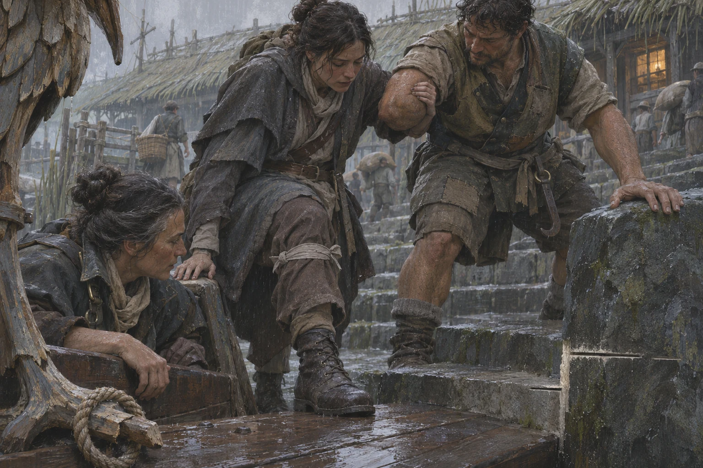
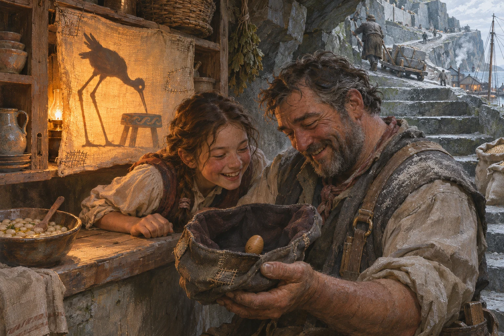
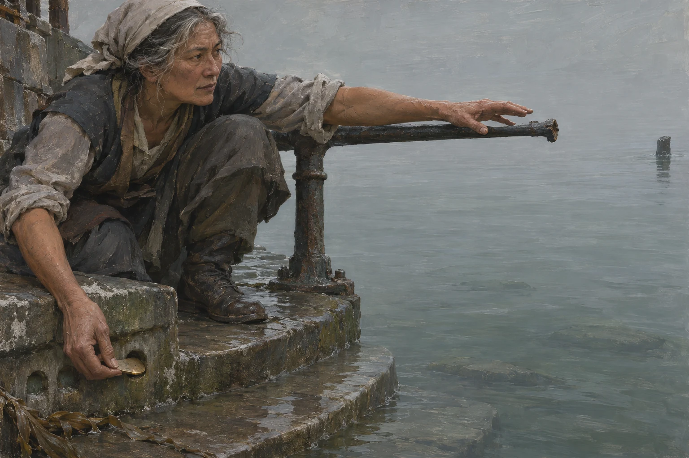
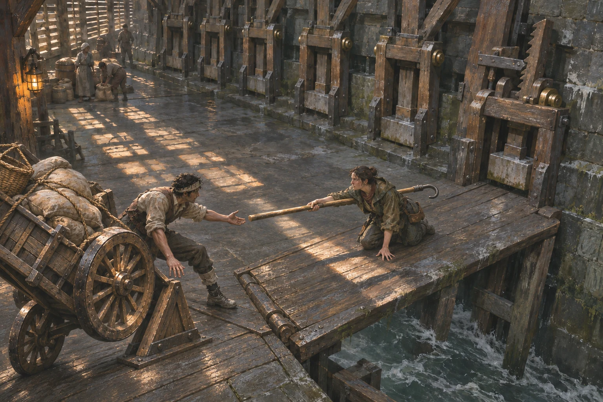

# Four scenes from the Inner Sound

At Gauge Steps the ferry crew and the surveyor have different ways to measure the drop. The surveyor has a cut in the stone. Tessa has the height a passenger can lift her boot. Use the distance between those two measurements to frame the landing.

## Orren · The long board

The passenger tests the plank with her heel before she gives it her weight. Tessa keeps her eye on the heel. The passenger has her eye on the rope ring. It is still round the heron's toe, and that throw counted.

**On the landing.** Frame the passenger, plank and misaligned chisel cuts from the boat. Keep the wet wood dark enough to see the sole touch down. The field-worker shown here is one possible player appearance. [The long board](../03-gameplay/orren-field-sequence.md)

## Keld · The cupboard show

The girl rolls the egg in the cap. One side has worn flat from all the times it has come down that fold in the cloth. She sets it on the flat to show her father. Behind them the next customer is holding a bowl with both hands, waiting to see what the bird will do.

**At the hatch.** One lamp makes the shadow sharp enough for a child on the stair to follow the joke. Let the blue daylight reach the quarry dust on the setter’s shoulder. The cloth, cap and egg could all be made or mended within a few steps of where they appear. [The kitchen on the turn](../01-world/island-life.md#keld--the-kitchen-on-the-turn)

## Sere · The third socket

Ada gets her nail behind the brass. Her other hand travels along the rail while she works. There is a stretch of water between its broken end and the next post. From here a visitor might guess how much iron is missing. Ada could tell them how many people used to queue along it.

**At the ebb.** Give the absent rail almost half the picture. Keep the three sockets in the shade and catch a small reflection on the loose tally. In close-up, the metal is the shore half of a passage record for a ferry that never came. [Ada and the third ferry](../02-narrative/cast-and-arcs.md#ada-sen--registrar-of-displaced-sere-claims)

## Selwick · The offered hook

The defender turns the iron in toward her own shoulder and sends the smooth end across. The worker has room for one step. At their other hand, daylight opens under a cartwheel. Both crews are watching which way that step goes.

**At the bridge.** Keep the handle and brace within one view from the safe shoulder. The small gap under the wheel and the gap between the two hands carry the choice. At gameplay distance the shutter light stripes the deck behind the handle. Give that patch of floor a single darker value in the blockout so a player can pick out the grip on approach. [The Sixth Jack](../02-narrative/campaign-spine.md#a9--the-sixth-jack-selwick)

These four generated paintings explore staging, light and material for the [visual direction](visual-and-audio-direction.md). Sere supplies the reference for coastal daylight. Keld gives inhabited interiors a warmer register. Carry the sharpest edges over to the places where a hand, boot or wheel meets something that can bear its weight.
